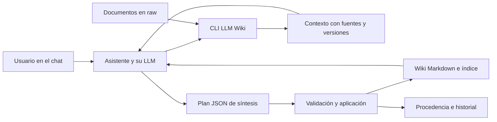

# LLM Wiki

**Convierte una carpeta de documentos en una wiki Markdown que tu asistente mantiene contigo.**

Instala la herramienta una vez, abre una carpeta vacía en el chat de tu asistente,
cuéntale quién eres y qué necesitas. Después incorpora documentos, consulta la wiki
y revisa sus contradicciones conservando las fuentes originales.

Este es un proyecto independiente de AgentCraft. Primera versión: **0.1.0**.
El nombre de distribución `llm-wiki-local` es provisional; no está publicado en PyPI.
Repositorio público: [juliansantamaria0/llm-wiki](https://github.com/juliansantamaria0/llm-wiki).

## Qué hace

- Inicializa una wiki personalizada, con perfil, instrucciones y skill local.
- Registra documentos por SHA-256 y conserva una copia sin sobrescribir originales.
- Extrae Markdown/texto UTF-8 y, con el extra opcional, PDFs con texto.
- Prepara el contexto para que el modelo del chat redacte síntesis y respuestas.
- Valida planes antes de actualizar páginas, índice, procedencia e historial.
- Detecta enlaces rotos, páginas aisladas, originales modificados y ediciones manuales.
- Evita pisar cambios recientes y permite recuperar escrituras interrumpidas.

La CLI **no incorpora un LLM ni llama a una API**. La lectura semántica y la
redacción las realiza el asistente donde abres la carpeta. Requiere acceso local a
archivos y terminal; un chat sin esas capacidades no puede ejecutar este flujo.
El proveedor del chat puede recibir los documentos que el asistente lea, según su
configuración y condiciones. Localidad de la CLI no significa inferencia local.



## Instalación una vez por equipo

Requiere Python 3.12 o posterior. Se recomienda pipx para aislar la aplicación.

```console
python -m pip install --user pipx
python -m pipx ensurepath
```

Reabre la terminal si el comando todavía no está en PATH. Desde la carpeta de este
repositorio descargado o descomprimido:

```console
pipx install .
llm-wiki --version
```

También se puede instalar la rueda distribuida junto al repositorio:

```console
pipx install ./llm_wiki_local-0.1.0-py3-none-any.whl
```

El ejemplo de rueda supone que estás en la carpeta que contiene ese archivo.
Para PDFs, al instalar desde el código usa `pipx install '.[pdf]'`, o sobre una
instalación existente: `pipx inject llm-wiki-local 'pypdf>=6.1,<7'`.

También puedes instalar directamente desde el repositorio público de GitHub:

```console
pipx install git+https://github.com/juliansantamaria0/llm-wiki.git
```

No ejecutes `pip install llm-wiki-local` suponiendo que corresponde a este código:
el nombre no ha sido reservado ni publicado.

## Empezar desde una carpeta vacía

Orden del flujo: instalar una vez → abrir carpeta → definir perfil → inicializar → trabajar.

Puedes pedir al asistente que ejecute la inicialización. Ejemplo de mensaje:

> Usa la herramienta instalada llm-wiki para inicializar esta carpeta. Mi wiki se
> llamará «Documentos de trabajo». Organizo contratos de servicios y necesito
> identificar compromisos, responsables, fechas y discrepancias entre versiones.
> Después lee las instrucciones que se generaron.

La CLI también incluye un asistente interactivo en terminal:

```console
mkdir mi-wiki
cd mi-wiki
llm-wiki init
```

Para que un asistente la ejecute sin interacción de terminal:

```console
llm-wiki init --no-input --name "Documentos de trabajo" --profile "Organizo contratos de servicios y necesito compromisos, responsables, fechas y discrepancias."
```

La carpeta debe estar vacía. La herramienta no modifica instrucciones existentes.
Tras inicializar, abre o recarga la carpeta en el asistente y pídele leer `AGENTS.md`.
Se generan skills en `.agents/skills/llm-wiki/` y `.claude/skills/llm-wiki/`, más
`CLAUDE.md`. La detección automática depende del cliente y no está certificada en
esta versión. Si no se activa, pide leer el SKILL.md manualmente. No se instala
ninguna skill global ni se cambia la configuración personal del asistente.

## Uso cotidiano en el chat

1. Deja archivos en `raw/` y escribe: **«Procesa los documentos nuevos de raw/»**.
2. Pregunta: **«¿Qué entregas hay pendientes? Cita las fuentes»**.
3. Pide: **«Revisa contradicciones, páginas aisladas y vacíos de información»**.

El asistente registra, prepara contexto, sintetiza y aplica planes. La herramienta
por sí sola no observa carpetas ni ejecuta trabajos en segundo plano. Una fuente
permanece pendiente cuando la extracción o la síntesis no se completan.

## Comandos

Ejecuta desde la raíz de la wiki. Desde otro lugar coloca `--project RUTA` **antes**
del subcomando. Los comandos operativos devuelven JSON; los errores van a stderr.

| Comando | Resultado |
| --- | --- |
| `llm-wiki init` | Pregunta nombre y perfil, crea la estructura |
| `llm-wiki add documento.pdf` | Registra una copia identificada por contenido |
| `llm-wiki scan` | Registra archivos de raw/, omitiendo raw/sources/ |
| `llm-wiki status` | Muestra fuentes, pendientes y número de páginas |
| `llm-wiki ingest ID` | Extrae la fuente y prepara contexto; no genera síntesis |
| `llm-wiki apply plan.json --dry-run` | Valida sin cambiar páginas ni metadatos |
| `llm-wiki apply plan.json` | Aplica páginas, índice, procedencia e historial |
| `llm-wiki query "pregunta"` | Prepara contexto para responder en el chat |
| `llm-wiki lint` | Informa problemas estructurales; código 1 si hay errores |
| `llm-wiki lint --strict` | Código 1 también si hay advertencias |
| `llm-wiki recover` | Revierte una transacción interrumpida |

`ingest` y `query` aceptan `--output ARCHIVO`; el directorio debe existir y el
archivo no debe existir. Esto evita sobrescribir contexto o planes anteriores.

## Estructura de una wiki

```text
mi-wiki/
├── AGENTS.md
├── CLAUDE.md
├── START_HERE.md
├── .agents/skills/llm-wiki/SKILL.md
├── .claude/skills/llm-wiki/SKILL.md
├── .llm-wiki/
│   ├── config.json          # Perfil y propósito
│   ├── state.json           # Fuentes, huellas y páginas registradas
│   └── drafts/              # Contextos y planes escritos por el asistente
├── raw/
│   └── sources/             # Copias verificables; no editarlas
├── wiki/
│   ├── index.md
│   ├── sources/
│   ├── concepts/
│   ├── entities/
│   └── syntheses/
└── log.md
```

Las copias originales y la wiki derivada son capas distintas. Una modificación
del original registrado se detecta; importa una nueva versión como otra fuente.
El historial registra importaciones y aplicaciones; no conserva por sí solo todas
las versiones anteriores de las páginas. Conserva backups completos, incluyendo
`.llm-wiki/`. El `.gitignore` generado excluye documentos, perfil, wiki e historial
por defecto; no es un mecanismo de cifrado ni control de acceso.

## Desarrollo y pruebas

```console
python -m venv .venv
# Windows PowerShell:
.venv\Scripts\Activate.ps1
# Linux/macOS:
# source .venv/bin/activate
python -m pip install -e '.[dev,pdf]'
ruff check .
ruff format --check .
pytest
python -m build
```

Consulta [VALIDATION.md](VALIDATION.md) para las comprobaciones de esta entrega y
[docs/implementation.md](docs/implementation.md) para el contrato de planes,
límites y decisiones de diseño. La integración continua está preparada para Windows
y Ubuntu con Python 3.12 y 3.13; su resultado remoto requiere publicar y ejecutarla.

## Publicar tu repositorio

Desde esta carpeta, después de revisar los archivos que se van a incluir:

```console
git init -b main
git add .
git diff --cached --stat
git commit -m "feat: initial LLM Wiki CLI"
gh repo create TU_USUARIO/llm-wiki --public --source . --remote origin --push
```

Si ya se inicializó Git, omite `git init`; si ya existe un remoto, úsalo. No incluyas
una wiki personal dentro del código público. El workflow de release solo construye
y adjunta paquetes a etiquetas `v*`; no publica en PyPI ni crea etiquetas por sí solo.

## Referencias de implementación

- [PyPA: pyproject.toml y entry points](https://packaging.python.org/en/latest/guides/writing-pyproject-toml/).
- [pipx: aplicaciones aisladas y fuentes de instalación](https://pipx.pypa.io/stable/).
- [Agent Skills: formato de SKILL.md](https://agentskills.io/specification).
- [Claude Code: skills](https://code.claude.com/docs/en/skills).
- [pypdf: extracción y límites de PDF](https://pypdf.readthedocs.io/en/stable/user/extract-text.html).

Licencia MIT. Contribuciones: abre un issue con un caso reproducible, conserva el
contrato JSON o documenta su migración y añade pruebas del comportamiento afectado.
